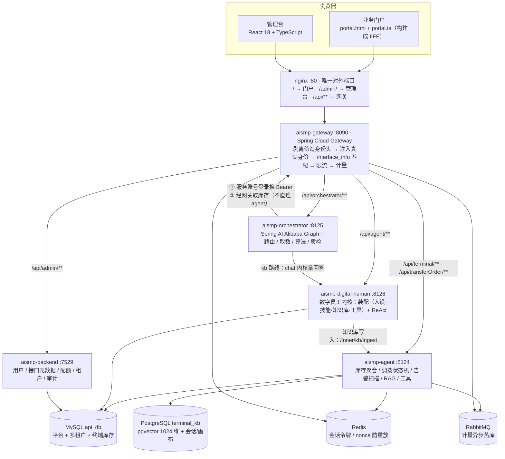
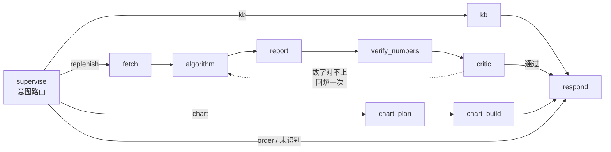
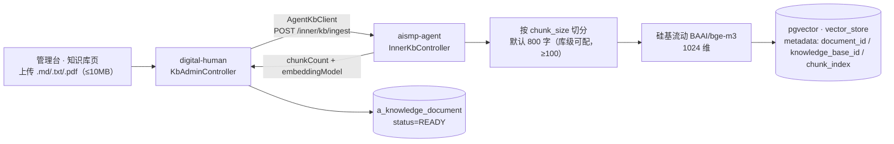
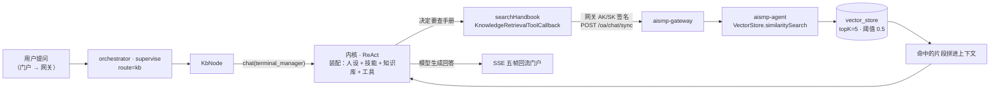

# NexusFlow AI

> [!IMPORTANT]
> **这是一个比赛演示项目（Competition Demo），不是生产级系统。**
> 数据为脱敏样例，演示账号口令固定为 `123456`；未做多副本、备份、审计合规与容量规划，
> 请勿直接用于生产。**欢迎提 Issue 与 PR**（见 [十一、参与贡献](#十一参与贡献欢迎-issue--pr)）。

> 面向运营商固网终端的 **AI 智能体平台**：在 API 开放平台的地基上，统一管理 REST API / AI Agent / MCP
> 三类服务的鉴权、限流与计量；落地场景是终端「补货建议 → 调拨闭环」的全流程自动化。
>
> 核心主张：**业务数字全部来自查库 + 确定性算法，LLM 不参与算数。**
>
> 技术栈：Java 21 / Spring Boot 4 / Spring AI 2.0 / Spring AI Alibaba Graph · TypeScript · 全套容器化。
>
> 仓库：<https://github.com/Li-Liu-hub/NexusFlow-AI> ·
> [提 Issue](https://github.com/Li-Liu-hub/NexusFlow-AI/issues/new) ·
> [提 PR](https://github.com/Li-Liu-hub/NexusFlow-AI/compare)

---

## 一、解决什么问题

终端库存分散在多级仓库里，「哪个仓该补货」原本靠人盯表格。NexusFlow AI 把它变成
**系统主动发现 → AI 给建议 → 数字落到工单**：

```
定时扫描库存（纯 SQL）
   ↓ 低于水位线
写告警通知给账管
   ↓ 点告警
数字员工给补货建议（卡片 + 数字来自算法）
   ↓ 点「提交调拨工单」
APPLIED 待确认出库 → OUTBOUND 在途 → DONE 已完成
   ↓ 任一环节驳回
REJECTED（已锁定量放回可用量）
```

关键约束：**在途不动库存**。只有 `DONE` 之后，B 仓减、A 仓增才原子发生。

---

## 二、架构



> 两个「不直连」的约定：**编排层取库存必须过网关**（业务接口在网关上做身份注入与登记，
> 直连 agent 会返回 `code:50000`）；**内核写知识库要回调 agent**（切片与嵌入只有 agent 有）。

**模块**：

| 模块 | 技术栈 | 端口 | 职责 |
|---|---|---|---|
| `aismp-backend` | Spring Boot 4 · JDK 21 · MyBatis-Plus | 7529 | 管理后端（含 `aismp-gateway` / `aismp-common` / `aismp-client-sdk` 子模块） |
| `aismp-agent` | Spring Boot 4 · Spring AI 2.0 | 8124 | 终端业务 + RAG(pgvector) + 工具 + 调拨状态机 |
| `aismp-digital-human` | Spring Boot 4 · Spring AI 2.0 | 8126 | 数字员工内核（配置驱动装配 + ReAct） |
| `aismp-orchestrator` | Spring Boot 4 · **Spring AI Alibaba Graph 2.0.0-M1.1** | 8125 | 图编排：路由 / 质检 / SSE 输出 |
| `aismp-frontend-admin` | React 18 · TypeScript · Vite · reactflow | — | 管理台（Agent / 技能 / KB / MCP / 画布 / 配额 / 审计） |
| `aismp-frontend-user` | TypeScript · Vite（lib 模式） | — | 业务门户：静态页 + 一份构建成 IIFE 的脚本 |

**基础设施**：MySQL 8.4（`api_db`）、PostgreSQL 18 + pgvector（`terminal_kb`，1024 维）、
Redis 8（会话 / nonce 防重放 / 建议缓存）、RabbitMQ 4（计量异步落库）、Nacos 3.2.4（注册与配置）。
**模型**：对话 `mimo-v2.6-flash`；嵌入 `BAAI/bge-m3`。

---

## 三、编排层（三条路线）

拓扑在 `aismp-orchestrator/.../graph/OrchestratorGraphConfig.java`：



| 路线 | 节点序列 | 关键实现 |
|---|---|---|
| `kb` 知识问答 | `supervise → kb → respond` | 转发内核（ReAct + 知识检索工具），见第五节 |
| `replenish` 补仓调拨 | `supervise → fetch → algorithm → report → verify_numbers → critic → respond` | `ReplenishAlgorithm`（纯函数）+ 数字闸门，回炉上限 1 次 |
| `chart` 图表 | `supervise → chart_plan → chart_build → respond` | 5 维度 × 4 样式，规则优先选型、LLM 兜底 |

- 状态契约在 `graph/StateKeys.java`，字段名与前端消费的 result 载荷一致。
- SSE 五种帧固定：`start / progress / agent_step / error / result`；前端与网关不感知实现语言。
- 三条路线共用同一套状态契约与 SSE 帧；未识别的意图收口到 `respond`，给一句人话而不是空白。
- 路由：带 `suggestion_id` 时直达建单（协议动作，不烧 LLM）；否则问一次模型做意图分类，
  解析失败重试 3 次后降级 `kb` —— 宁可回答得泛，也不给用户丢一个 error 帧。

---

## 四、几个关键设计

**1. 数字红线** —— LLM 会说错数字，所以数字不进 LLM 的嘴。补货量 / 缺口 / 周转天数全由代码算；
`verify_numbers` 做代码 diff 闸门，卡片数字必须与算法输出逐项相等，否则回炉。

**2. 网关身份「先剥离再注入」** —— 客户端带来的身份头一律当伪造剥掉，再由网关按签名结果注入真实身份，
然后才匹配 `interface_info`；签名带 nonce + Redis SETNX 防重放。

**3. 调拨 CAS 整单回滚** —— 出库确认按串码批量更新，`updated != distinct.size()` 时整单回滚，
避免「一半出库、一半在途」。

**4. 工具沙箱** —— SQL 工具用词边界正则拦写操作（避免 `create_time` 这类列名误伤）；
API 调用工具按身份校验接口白名单，越权直接拒。

**5. 图构建不写 eval** —— 节点白名单化，环靠条件边 + 回炉上限 + `recursionLimit=20` 收口；拓扑有单测断言。

---

## 五、检索增强（RAG）

知识问答复用 **aismp-agent 的 RAG**，内核不另建一套检索 —— 它把「问知识库」做成一个**可挂载的工具**
（`searchHandbook`，类型 `KB_RETRIEVAL`）。这样做的好处是写入方与检索方同构：
同一个 `PgVectorStore`、同一套 metadata，不会出现「切片按 A 规则、召回按 B 规则」。

### 写入：管理台上传知识库



### 读取：对话时的检索



### 关键参数

| 参数 | 值 | 在哪 |
|---|---|---|
| 嵌入模型 | `BAAI/bge-m3`（1024 维） | `aismp-agent/application.yml`（硅基流动） |
| 向量列 | `vector_store.embedding vector(1024)` | `db/pg/01-schema-terminal_kb.sql` |
| 切片长度 | 默认 800 字符，库级可配（≥100） | `a_knowledge_base.chunk_size` |
| 检索条数 | topK = 5 | `SearchKnowledgeBaseTool` |
| 相似度阈值 | 0.5 | 同上 |
| 上传限制 | 单文件 ≤ 10MB | `KbAdminController` |
| 工具登记 | `searchHandbook`（KB_RETRIEVAL） | `a_llm_tool.config_json` |

### 几个取舍

- **嵌入必须外接**：对话模型 MiMo 只提供 chat / asr / tts，没有 embedding 接口。
- **检索是工具调用，不是前置 RAG**：内核按需决定查不查（闲聊、复述类问题不查），
  避免把无关片段硬塞进上下文 —— 也是「能用 workflow 就不堆 context」的同一条原则。
- **数字问题不走 RAG**：库存/补货/图表走第三节的算法路线，知识库只答「流程该怎么走」。
- **已知历史包袱**：`searchHandbook.config_json` 里的 `endpoint` 仍是 `/oa/chat/sync`
  （OA 场景留下的路径名，语义上就是 agent 的 RAG 入口）。改名要同时动库里配置与 agent 路由，
  收益只是好看，暂不改。

---

## 六、多租户（公司）模型

数据模型已落地（`db/mysql/05-tenant-schema.sql`），口径复用库里既有的 `ent_code`：

| 表 | 作用 |
|---|---|
| `a_tenant` | 公司主表（`ent_code` 全局唯一） |
| `a_user.ent_code` | 员工归属公司 |
| `a_tenant_page` | 每家公司可见页面（`visible` + `sort_order`）→ 不同公司看到不同导航 |
| `a_tenant_feature` | 已开通能力（`NODE` / `PAGE` / `TOOL`），`NODE` 指向画布节点定义 |
| `a_feature_ticket` + `a_feature_ticket_log` | 公司申请功能 → 总部审批留痕 |
| `a_token_quota`（`scope='TENANT'`） | 按公司分配月度 token；用量按 `a_token_usage_daily.ent_code` 汇总 |

生效链路：**公司提工单 → 总部审批通过 → 写 `a_tenant_feature` → 该公司画布可用节点 =
内置节点 ∪ 已授权节点**。

> 落地状态：schema 与验证脚本已完成；后端接口、管理台页面、门户按公司渲染是下一步。

---

## 七、快速开始

### 7.1 容器化部署

```bash
bash deploy/server-docker/collect-artifacts.sh   # ① 构建 5 个 jar + 前端产物（含门户脚本）
bash scripts/push-dockerhub.sh --tag 20261020    # ② 推镜像
bash scripts/deploy.sh                           # ③ 服务器铺配置、起容器、验证
```

> `collect-artifacts.sh` 结束时校验 **6 个产物**（5 个 jar + 门户脚本），缺任何一个直接失败 ——
> 以前是静默少包，部署后才发现某个服务起不来。

### 7.2 本机

```bash
# 建库（结构 + 配置种子，不含业务数据）
mysql -h127.0.0.1 -uroot -p --default-character-set=utf8mb4 < db/mysql/01-schema-api_db.sql
mysql -h127.0.0.1 -uroot -p --default-character-set=utf8mb4 < db/mysql/10-seed-api_db.sql
mysql -h127.0.0.1 -uroot -p --default-character-set=utf8mb4 < db/mysql/05-tenant-schema.sql
psql -h127.0.0.1 -U postgres -d terminal_kb -f db/pg/01-schema-terminal_kb.sql
psql -h127.0.0.1 -U postgres -d terminal_kb -f db/pg/10-seed-terminal_kb.sql

bash scripts/start-all.sh         # 一键起全部服务（日志在 local-init/logs/）
bash scripts/start-all.sh --stop  # 停
```

`scripts/start-all.sh` 已封装本机三个必做动作：`unset SERVER_PORT/SERVER__PORT`（会劫持 `server.port`）、
`ESBUILD_BINARY_PATH` 指到 ASCII 路径（中文路径下的 esbuild 被安全软件拦）、清 `NODE_OPTIONS`。

### 7.3 环境变量

```bash
# Java 侧
setx MIMO_API_KEY "<MiMo 对话模型 Key>"
setx SILICONFLOW_API_KEY "<硅基流动嵌入 Key>"

# 编排层（aismp-orchestrator）
export ORCH_SVC_USER="svc_orchestrator"      # 换内核令牌的服务账号
export ORCH_SVC_PASSWORD="<口令>"
export DIGITAL_HUMAN_DIRECT_URL="http://127.0.0.1:8126"
```

**门户脚本不是源码**：`aismp-frontend-user/public/portal.js` 由 `src/portal/portal.ts` 构建生成
（已进 `.gitignore`），改脚本请改 TS 再 `npm run build`。

---

## 八、测试

```bash
bash scripts/test-all.sh          # 全量门禁，失败非零退出
bash scripts/test-all.sh --no-db  # 跳过需要 MySQL 的那步
```

| 步骤 | 覆盖 | 结果 |
|---|---|---|
| `aismp-orchestrator` | 图拓扑 / 路由与降级 / 补货算法 / 数字闸门 / 图表选型 / 可见范围 / SSE 帧 | **75 passed** |
| `db/mysql/verify-tenant-schema.sh` | 迁移幂等 + 结构 + 种子 + 中文 UTF-8 | **16 项** |
| `aismp-frontend-admin` | `tsc --noEmit` + 登录态 / 请求封装 | **21 passed** |
| `aismp-frontend-user` | `tsc --noEmit` | 通过 |

需要部署环境才能做的验收（不在门禁内，按「快速开始」的步骤手工执行）：
全链路 50 项、调拨闭环 24 项、告警 → 建议 → 工单闭环 18 项、画布链路 9 项。

---

## 九、目录结构

```
NexusFlow-AI/
├── aismp-backend/           # 管理后端 + 网关 + common + client-sdk
├── aismp-agent/             # 终端业务 + RAG + 工具
├── aismp-digital-human/     # 数字员工内核
├── aismp-orchestrator/      # 图编排（graph / llm / client + 单测）
├── aismp-frontend-admin/    # 管理台（React + TS）
├── aismp-frontend-user/     # 门户：public/ 静态页 + src/portal/portal.ts
├── db/                      # 建库 SQL（mysql: api_db / pg: terminal_kb）
├── deploy/                  # 容器化部署 + 服务器加固脚本
├── local-init/              # 本机启动、分批次 registry SQL、E2E 脚本
└── scripts/                 # start-all / deploy / push / test-all
```

---

## 十、开发约定

- 密钥（API Key / `.env` / 令牌 / 凭据）**不进仓库**，`.gitignore` 已覆盖
- 提交信息说清「做了什么」，中文即可
- **前端改动必须亲眼验证渲染** —— 「接口 200 + 构建通过」不等于页面正常
- **查库前先查 `information_schema.columns`** —— 列名写错会静默返回空而不报错
- 改动后先跑 `scripts/test-all.sh`，再谈提交

---

## 十一、常见问题

| 症状 | 原因 | 解法 |
|---|---|---|
| 网关 403 但签名没错 | 接口未登记 / 用了 `localhost` | 查 `interface_info`（列名是 `url`）；改 `127.0.0.1` |
| 查询返回空但不报错 | 列名写错 | 先查 `information_schema.columns` |
| 管理台白屏 | vite `base` 不是 `/admin/` | 见 `collect-artifacts.sh` 注释 |
| 服务注册成 127.0.0.1 | jar 里写死 `discovery.ip` | compose 显式设固定 IP `172.28.0.11~15` |
| `esbuild winapi error #5` | 中文路径下的 exe 被拦 | `ESBUILD_BINARY_PATH` 指 ASCII 路径 |
| 端口与配置不符 | `SERVER_PORT` / `SERVER__PORT` 劫持 | unset 后显式 `--server.port=` |
| 编排层启动报类版本错 | 用 JDK 17 跑 21 编译的 class | `JAVA_HOME` 指向 JDK 21 |
| PG 容器起不来 | postgres 18 改了 PGDATA 约定 | 挂 `/var/lib/postgresql` |

---

## 十二、参与贡献（欢迎 Issue / PR）

本项目是**比赛演示项目**，但它不是玩具仓库：欢迎任何形式的反馈 —— 发现 bug、文档写错、
觉得某个设计站不住脚，都可以直接开 Issue；想动手改，随时提 PR。

### 提 Issue

请带上这几样，能省掉一半来回：

- **环境**：操作系统 / JDK 版本 / 浏览器（前端问题）
- **复现步骤**：从哪一步开始、点了什么
- **期望 vs 实际**：最好附截图或日志片段
- **日志位置**：服务日志在 `local-init/logs/`；容器里用 `docker logs ap-<服务名>`

> 安全问题（凭据泄露、越权、注入）请**不要**开公开 Issue，直接私信维护者。

### 提 PR

1. Fork 后从 `main` 开分支，命名 `feat/xxx`、`fix/xxx`、`docs/xxx`
2. **先在本地过门禁**：`bash scripts/test-all.sh`（Java 单测 + 多租户 DB 校验 + 两端 TypeScript）
3. 提交信息说清「做了什么」，中文没问题；一次 PR 只做一件事
4. PR 描述里写三件事：改了什么、为什么改、**怎么验证的**（贴命令输出或截图）
5. 不要提交密钥、`.env`、`credentials.env`、构建产物（`.gitignore` 已覆盖）

### 代码约定

见 [九、开发约定](#九开发约定) —— PR 请照着那四条来，尤其是「密钥不进仓库」和「改完先跑门禁」。

---

## 十三、License

见根目录 `LICENSE`。
