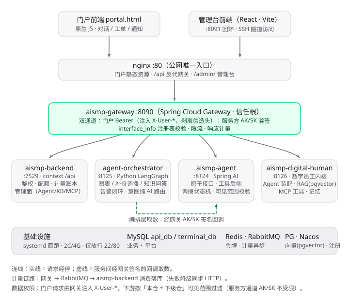

# 终端 AI 智慧管理平台

> 在 **API 开放平台**地基上构建的智能体平台：统一网关管理 REST API / AI Agent / MCP 三类服务的
> 鉴权、限流与计量；落地场景为**运营商固网终端「补货建议 + 调拨闭环」**。
>
> 核心特征：**业务数字全部来自查库 + 确定性算法，LLM 不参与算数**。

---

## 一、这是什么

把「仓库库存该补货了」这件事，从**人工发现**变成**系统主动发现 → AI 给建议 → 数字调到落地**的闭环：

```
定时扫描库存（纯 SQL）
   ↓ 低于水位线
写告警通知给账管
   ↓ 点告警
数字员工给补货建议（卡片 + 数字来自算法）
   ↓ 点「提交调拨工单」
调拨单 APPLIED 待确认出库
   ↓ 调出方仓管导入串码确认出库
OUTBOUND 已出库（在途）
   ↓ 调入方仓管确认入库
DONE 已完成 —— 库存此时才真正 B 减 A 增
```

---

## 二、架构总览



```
浏览器（门户 / 管理台）
        │
        ▼
┌──────────────────────────────────────────────────┐
│  nginx  :80   唯一对外端口                        │
│  /        → 业务门户    /admin/ → 管理台           │
│  /api/**  → 反代到网关                            │
└──────────────────────────────────────────────────┘
        │
        ▼
┌──────────────────────────────────────────────────┐
│  aismp-gateway  :8090    Spring Cloud Gateway    │
│  ① 剥离客户端伪造身份头 → ② 注入真实身份           │
│  ③ interface_info 精确匹配 → ④ 限流 → ⑤ 计量      │
└──────────────────────────────────────────────────┘
        │
        ├─► /api/terminal/**, /api/transferOrder/**  → aismp-agent :8124
        │      终端业务：库存聚合 / 调拨状态机 / 告警扫描
        │      ReAct 智能体 + RAG(pgvector) + 工具
        │
        ├─► /api/agent/**                            → aismp-digital-human :8126
        │      数字员工内核：装配（角色/技能/知识库/工具）+ ReAct
        │
        └─► /api/orchestrator/**                     → agent-orchestrator :8125
               Python FastAPI + LangGraph 编排（只管路由与质检）
               三条业务路线，见下节
```

**编排层三条业务路线**（`graph.py`，1499 行）：

| 路线 | 节点序列 | 说明 |
|---|---|---|
| `replenish` 补仓调拨 | `supervise → fetch → algorithm → report → verify_numbers → critic → respond` | 含**回炉环**（critic 不合格回流重算） |
| `chart` 图表 | `supervise → chart_plan → chart_build → respond` | LLM 选维度+样式，数据取接口原值 |
| `kb` 知识问答 | `supervise → digital_human → respond` | 转发数字员工内核 |

**数字红线**：`algorithm` 节点用代码算数（`agent-orchestrator/tools/algorithms.py`），
`verify_numbers` 节点做**代码 diff 闸门**（卡片数字必须 === 算法输出），不一致则回炉。
LLM 只决定「跑哪个算法、传什么参数」。

**画布编排**（增量能力）：编排逻辑不写死，由管理端画布发布的图驱动
（`GRAPH_SOURCE=dsl`），支持版本固化与回滚、按会话粘版本。

---

## 三、模块与技术栈

| 模块 | 技术栈 | 端口 | 说明 |
|---|---|---|---|
| `aismp-backend` | **Spring Boot 4.0.7 · JDK 21** · MyBatis-Plus | 7529 | 管理后端：用户 / 接口元数据 / 计量账本 |
| `aismp-gateway` | Spring Cloud Gateway（WebFlux） | 8090 | 鉴权 + 限流 + 计量（**Dubbo 已移除，改 HTTP + Nacos lb**） |
| `aismp-agent` | **Spring Boot 4.0.7 · JDK 21** · Spring AI 1.0.3 | 8124 | 终端业务 + RAG + 工具 + 调拨状态机 |
| `aismp-digital-human` | **Spring Boot 4.0.7 · JDK 21** | 8126 | 数字员工内核（装配 + ReAct） |
| `agent-orchestrator` | Python 3.12 · LangGraph · FastAPI | 8125 | 编排层（路由 / 质检 / 画布 DSL 加载） |
| `aismp-frontend-user` | Vite（原生 JS 门户） | — | 业务门户（对话 / 库存 / 工单 / 通知） |
| `aismp-frontend-admin` | React 18 · Vite · reactflow 11 | — | 管理台（Agent / 技能 / KB / MCP / 画布 / 配额 / 审计） |

> `aismp-frontend-master` 是早期 Umi 工程，**已非主战场**，保留仅作参考。

**基础设施**：

| 服务 | 版本 | 用途 |
|---|---|---|
| MySQL | 8.4 | 业务数据（库 `api_db`） |
| PostgreSQL + pgvector | 18 + 0.8.x | 知识库向量（库 `terminal_kb`，**1024 维**）+ 编排图存储 |
| Redis | 8 | 会话、nonce 防重放、建议缓存（30 分钟） |
| RabbitMQ | 4 | 计量消息异步落库 |
| Nacos | **3.2.4** | 服务注册与配置（**Nacos 3.x 天生重，容器内存至少 768m**） |

**模型**：对话 **MiMo `mimo-v2.6-flash`**；嵌入 **硅基流动 `BAAI/bge-m3`（1024 维）**。

---

## 四、快速开始

### 4.1 远端一键部署（推荐）

```bash
# ① 本机：构建产物（jar + 前端静态文件）
bash deploy/server-docker/collect-artifacts.sh

# ② 本机：推送镜像到 Docker Hub
bash scripts/push-dockerhub.sh --tag 20261011

# ③ 服务器：铺配置 + 起容器 + 验证
bash scripts/deploy.sh
```

> **② 的前置条件（本机特有，踩过坑）**：
> - **Docker Desktop 必须能起来**。它需要 WSL2 后端，而本机安装了奇安信天擎，
>   且 `wsl.exe` 在程序黑名单里 → 后端起不来时 Docker Desktop 进程会在数秒内自毁。
>   已实测可行的组合：**Windows 处于 WORK MODE（`HypervisorPresent=True`）**
>   + 在 `%APPDATA%\Docker\settings-store.json` 里把
>   `OverrideProxyHTTP/HTTPS` 指向本机代理（如 `http://127.0.0.1:7897`）——
>   配代理后 Docker Desktop 就不再异常退出（实测稳定 2 分钟以上）。
>   判断当前是否 WORK MODE：`(Get-CimInstance Win32_ComputerSystem).HypervisorPresent`。
> - **Docker Hub 从国内直连不通**，必须走代理：给脚本传 `--proxy http://127.0.0.1:7897`
>   （或设 `HTTP_PROXY`）。代理需能访问 `registry-1.docker.io` / `auth.docker.io`。
> - Docker Hub 凭据优先复用 Windows 凭据管理器里已有的 `jsyl6` 登录态；
>   也可 `DOCKER_TOKEN=<pat> bash scripts/push-dockerhub.sh`。推送私有仓库前
>   记得在 Docker Hub 网页上先建好仓库并选 Private（首次 push 会自动建成公开库）。

部署后入口：

| 入口 | 地址 |
|---|---|
| 业务门户 | `http://<服务器IP>/` |
| 管理台 | `http://<服务器IP>/admin/` |

演示账号（口令统一 `123456`）：`xn_zg` 新区账管 / `dn_kg` 东宁仓管 / `xn_kg` 新区仓管 / `admin` 管理员。
完整演示流程见 **`docs/演示剧本.md`**。

### 4.2 本机开发

```bash
# 1) 建库（结构 + 配置种子，不含业务数据）
mysql -h127.0.0.1 -uroot -p --default-character-set=utf8mb4 < db/mysql/01-schema-api_db.sql
mysql -h127.0.0.1 -uroot -p --default-character-set=utf8mb4 < db/mysql/10-seed-api_db.sql
psql -h127.0.0.1 -U postgres -d terminal_kb -f db/pg/01-schema-terminal_kb.sql
psql -h127.0.0.1 -U postgres -d terminal_kb -f db/pg/10-seed-terminal_kb.sql

# 2) 导入业务数据（28354 条终端 + 仓位）
#    数据源在 local-init/import-terminal.py（读工作区根目录的 xlsx）

# 3) 一键启动全部服务
bash scripts/start-all.sh
```

**本机启动三件套**（`scripts/start-all.sh` 已封装）：

1. `unset SERVER_PORT SERVER__PORT` —— 本机这两个环境变量会**劫持 `server.port`**
2. `export ESBUILD_BINARY_PATH=D:/env/esbuild/esbuild.exe` —— **奇安信会拦中文路径下的 exe**
   （现象：`Cannot read file "package.json": winapi error #5`）
3. `export NODE_OPTIONS=` —— WorkBuddy 注入的 safe-delete 守卫会拦 `rimraf`

### 4.3 环境变量

**Java 侧**（仓库不含真值，由环境或 `.env` 提供）：

```powershell
setx MIMO_API_KEY "<MiMo 对话模型 Key>"
setx SILICONFLOW_API_KEY "<硅基流动嵌入 Key>"
setx MYSQL_APP_PW "<MySQL 应用账号口令>"
setx REDIS_PW "<Redis 口令>"
```

**编排层**：`cp agent-orchestrator/.env.example agent-orchestrator/.env` 后填值
（网关三元组 / LLM 三项 / `GRAPH_SOURCE=dsl`）。

---

## 五、目录结构

```
agent-platform/
├── aismp-backend/           # 管理后端 + 网关
├── aismp-agent/             # 终端业务 + RAG
├── aismp-digital-human/     # 数字员工内核
├── agent-orchestrator/      # LangGraph 编排层
│   ├── graph.py             # 三条业务路线（1499 行）
│   ├── canvas/              # 画布 DSL → StateGraph
│   ├── tools/algorithms.py  # 确定性算法（数字红线所在）
│   └── tests/               # 117 个单测
├── aismp-frontend-user/     # 业务门户
├── aismp-frontend-admin/    # 管理台
├── db/                      # ★ 建库 SQL（结构 + 配置种子，无业务数据）
│   ├── mysql/               # api_db（生产）/ terminal_db（废弃参考）
│   └── pg/                  # terminal_kb（向量 + 编排图）
├── docs/                    # 设计文档
│   ├── 开发方案.md            # M0~M6 模块拆解与验收标准
│   ├── contracts/           # 接口契约（数据模型 / REST / SSE）
│   ├── 演示剧本.md            # 比赛演示脚本
│   ├── 知识库评估报告.md       # 20 题 × 3 遍评估
│   └── 架构重构-进度与交接.md   # 逐项功能与验收记录
├── deploy/                  # 部署脚本
│   ├── server-docker/       # 全量容器化（当前方案）
│   └── server-secure/       # 服务器加固脚本
├── local-init/              # 本机启动 + 分批次 registry SQL（39 个）
└── scripts/                 # ★ 四个运维脚本
    ├── push-dockerhub.sh    # 推镜像到 Docker Hub
    ├── deploy.sh            # 部署到服务器
    ├── push-gitee.sh        # 推送代码到 Gitee
    └── start-all.sh         # 本机一键启动
```

---

## 六、运维脚本

| 脚本 | 用途 | 常用方式 |
|---|---|---|
| `scripts/push-dockerhub.sh` | 构建并推送镜像到 Docker Hub | `bash scripts/push-dockerhub.sh --tag 20261011` |
| `scripts/deploy.sh` | 部署到远端服务器（可只更应用） | `bash scripts/deploy.sh [--apps-only] [--check]` |
| `scripts/push-gitee.sh` | 推送代码到 Gitee（含凭据坑绕过） | `bash scripts/push-gitee.sh [branch]` |
| `scripts/start-all.sh` | 本机一键启动全部服务 | `bash scripts/start-all.sh [--stop]` |

---

## 七、验收与测试

| 脚本 | 覆盖 | 结果 |
|---|---|---|
| `deploy/acceptance.py` | 全链路端到端 | **50/50** |
| `local-init/transfer-flow-e2e.py` | 调拨闭环 | **24/24** |
| `local-init/stock-alert-closed-loop-e2e.py` | 告警→建议→工单闭环 | **18/18** |
| `deploy/server-secure/_r12/_r14/_r15-*.py` | 门户公网 / 写入授权 / 数据范围 | **12/12 · 6/6 · 15/15** |
| `deploy/server-docker/canvas_link_test2.py` | 画布编排拓扑级实验 | **9/9** |
| `agent-orchestrator/tests/` | 编排层单测 | **117 passed** |
| 知识库评估（20 题 × 3 遍） | 关键词命中 + LLM 判官 | **92.9% / 90.0%** |

---

## 八、开发约定

- 密钥（API Key / `.env` / 令牌 / 凭据文件）**任何情况下不进仓库**（`.gitignore` 已覆盖）
- 提交信息说清「做了什么」，中文即可
- **前端改动必须亲眼验证渲染** —— 「接口 200 + 构建通过」不等于页面正常
  （曾有 vite `base` 配错导致管理台白屏、布局算法发散导致画布空白，均只有真机可发现）
- **查库前先用 `information_schema.columns` 核实列名** —— 用错列名会**静默返回空**而不报错

---

## 九、常见问题

| 症状 | 原因 | 解法 |
|---|---|---|
| 网关 403 但签名没错 | 接口未登记，或用了 `localhost`（网关只听 IPv4） | 查 `interface_info`（**列名是 `url`**）；改用 `127.0.0.1` |
| 查询一直返回空但不报错 | 列名写错 | 先查 `information_schema.columns` |
| 管理台白屏 | vite `base` 不是 `/admin/` | 见 `collect-artifacts.sh` 注释 |
| 应用注册成 127.0.0.1 | jar 里写死 `discovery.ip` | compose 里显式设固定 IP `172.28.0.11~15` |
| `esbuild winapi error #5` | 奇安信拦中文路径下的 exe | 设 `ESBUILD_BINARY_PATH` 到纯 ASCII 路径 |
| 端口与配置不符 | `SERVER_PORT` / `SERVER__PORT` 劫持 | `unset` 后显式 `--server.port=` |
| PG 容器起不来 | postgres 18 改了 PGDATA 约定 | 挂 `/var/lib/postgresql`（不是 `/data`） |
| 推送 Gitee 挂死 | credential helper 弹 GUI | 用 `scripts/push-gitee.sh`（已绕过） |

---

## 十、相关文档

| 文档 | 内容 |
|---|---|
| `docs/开发方案.md` | M0~M6 模块拆解、验收标准、风险清单 |
| `docs/contracts/01-数据模型.md` | 数据模型设计意图 |
| `docs/contracts/02-业务接口契约.md` | REST 契约 + 身份权限 + 网关登记规则 |
| `docs/contracts/03-SSE事件协议.md` | SSE 事件、卡片协议、前端消费示例 |
| `docs/演示剧本.md` | 比赛演示全流程（含限额拦截表演） |
| `docs/知识库评估报告.md` | 知识库评估三遍对照实验 |
| `docs/架构重构-进度与交接.md` | 逐项功能与验收记录（§5.1~5.23） |
| `deploy/server-docker/README.md` | 容器化部署细节与坑速查 |
| `db/README.md` | 建库与种子数据说明 |
